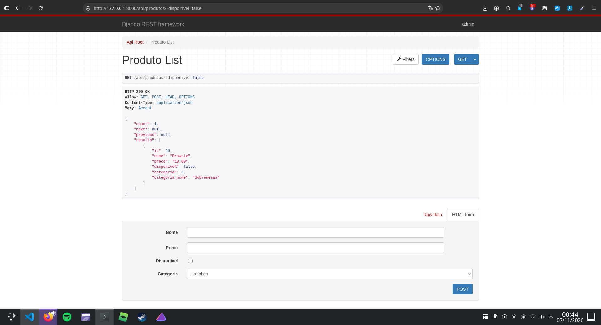
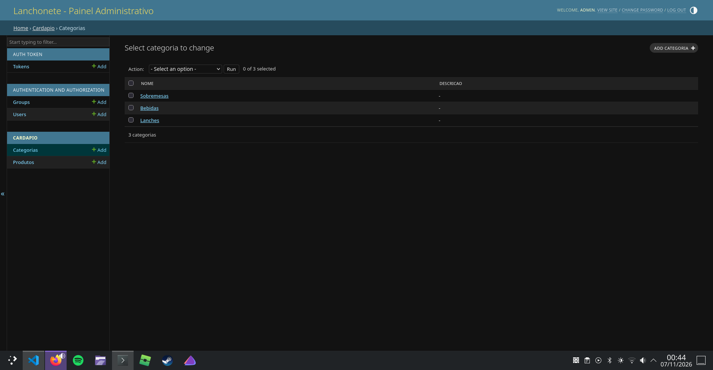
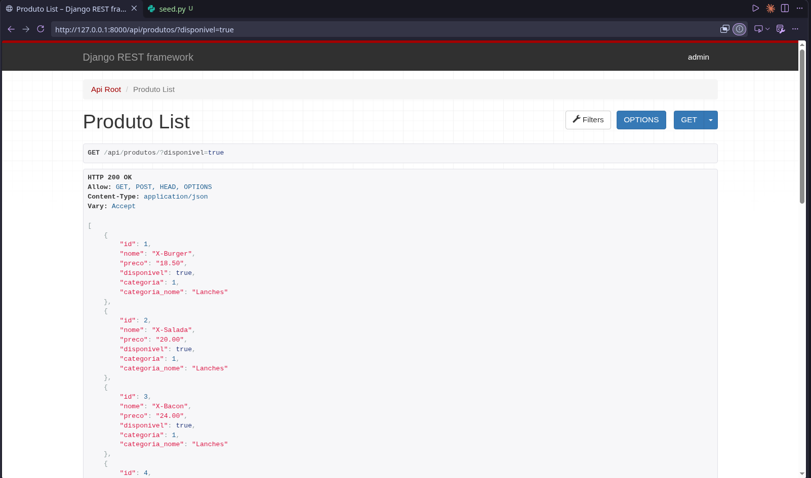
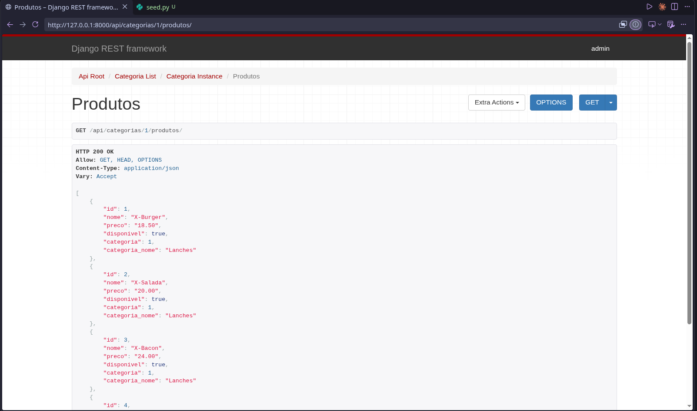
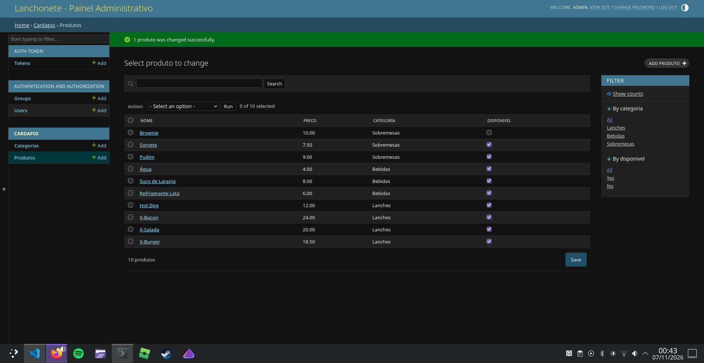
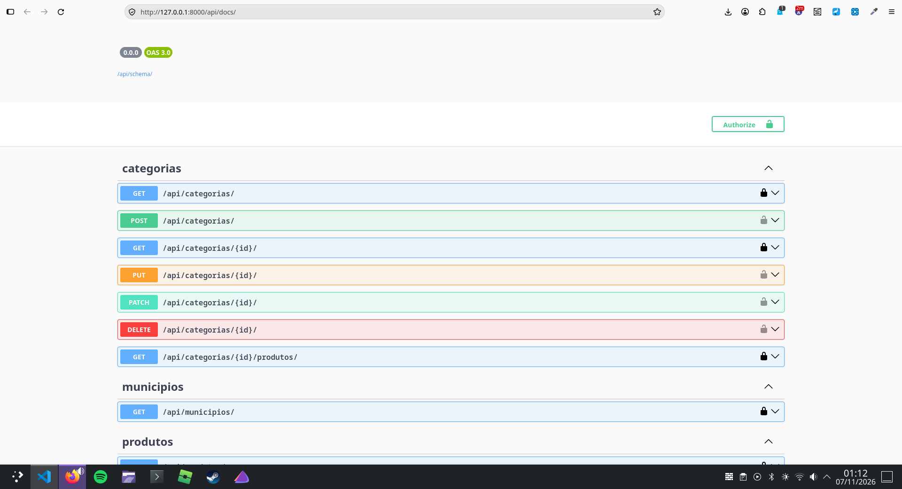
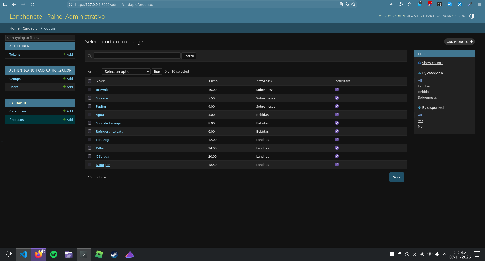
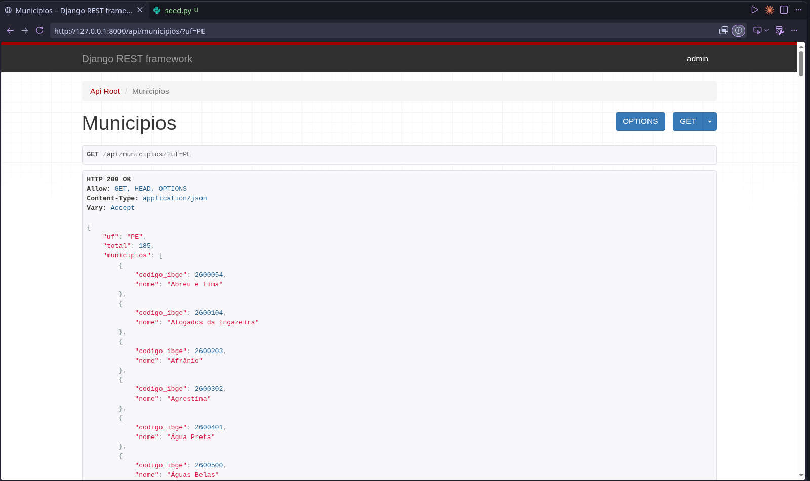
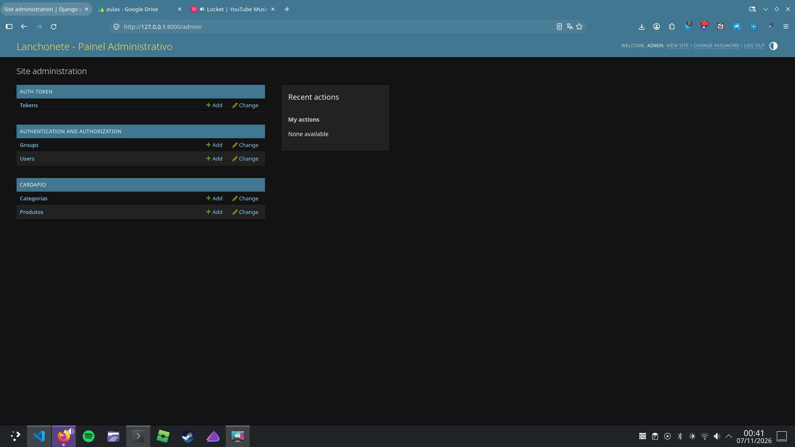

# Lanchonete API 🍔

## 1. Apresentação

* **Nome do projeto:** Lanchonete API
* **Aluno:** Matheus
* **Descrição:** Sistema feito para organizar o cardápio de uma lanchonete de bairro. Ele tem duas partes. A primeira é um painel administrativo (Django Admin), onde o dono da lanchonete cadastra e gerencia categorias e produtos no dia a dia. A segunda é uma API REST feita com Django REST Framework (DRF), que no futuro poderá ser usada por um site ou aplicativo de pedidos. A API valida o preço dos produtos, filtra por disponibilidade, busca por nome, pagina os resultados e exige token para criar, alterar ou excluir dados (a leitura é livre). Como extra, ela também consulta a API pública do IBGE para listar os municípios de um estado, pensando nas futuras entregas.

---

## 2. Tecnologias

* **Python:** linguagem usada em todo o back-end (testado com Python 3.13).
* **Django (6.1.3):** framework web que fornece o ORM, as migrações e o painel administrativo.
* **Django REST Framework (3.18.3):** biblioteca em cima do Django que facilita criar a API, com serializers, viewsets e routers.
* **Token Authentication (`rest_framework.authtoken`):** parte do DRF que gera um token para o usuário se autenticar na API.
* **SQLite:** banco de dados em arquivo, simples, usado durante o desenvolvimento.
* **requests:** biblioteca para fazer requisições HTTP a outras APIs; é usada para consultar o IBGE.
* **drf-spectacular:** gera automaticamente a documentação interativa da API (Swagger/OpenAPI).

---

## 3. Como rodar o projeto

1. **Clone o repositório:**
   ```bash
   git clone https://github.com/matheusSantkk/lanchonete-api.git
   cd lanchonete-api
   ```

2. **Crie e ative o ambiente virtual:**
   * Windows:
     ```bash
     python -m venv venv
     venv\Scripts\activate
     ```
   * Linux / macOS:
     ```bash
     python3 -m venv venv
     source venv/bin/activate
     ```

3. **Instale as dependências:**
   ```bash
   pip install -r requirements.txt
   ```

4. **Aplique as migrações** (os arquivos de migração já estão no repositório, então basta o `migrate`):
   ```bash
   python manage.py migrate
   ```

5. **Carregue os dados de teste** (3 categorias e 10 produtos, vindos da fixture `cardapio.json`):
   ```bash
   python manage.py loaddata cardapio.json
   ```

6. **Crie o superusuário** para entrar no admin. Use usuário `admin` e senha `admin123`, que são os dados de teste citados na seção 7. O Django vai avisar que a senha é fraca; é só confirmar com `y`:
   ```bash
   python manage.py createsuperuser
   ```

7. **Inicie o servidor:**
   ```bash
   python manage.py runserver
   ```

Depois disso, acesse:
* API: `http://127.0.0.1:8000/api/`
* Documentação Swagger: `http://127.0.0.1:8000/api/docs/`
* Django Admin: `http://127.0.0.1:8000/admin/`

---

## 4. Estrutura do projeto

O projeto tem a pasta de configuração `lanchonete/` e o app `cardapio/`.

* `lanchonete/settings.py`: configurações do projeto. Lá ficam os apps instalados (incluindo `rest_framework`, `rest_framework.authtoken`, `drf_spectacular` e `cardapio`), o banco SQLite e as configurações do DRF (autenticação por token, permissão `IsAuthenticatedOrReadOnly`, paginação de 5 itens por página e o gerador de schema do Swagger).
* `lanchonete/urls.py`: rotas principais. Liga `admin/`, `api/` (que inclui as rotas do app `cardapio`), `api/token/` (gera o token) e `api/schema/` e `api/docs/` (documentação).
* `cardapio/models.py`: define as classes `Categoria` e `Produto`, que viram tabelas no banco pelo ORM do Django. O `Produto` tem uma `ForeignKey` para `Categoria`.
* `cardapio/serializers.py`: converte os objetos dos models em JSON (e o JSON recebido em objetos). Também tem a validação que impede preço negativo e o campo extra `categoria_nome`.
* `cardapio/views.py`: lógica dos endpoints. Tem os `ModelViewSet` de categoria e produto (com o filtro `?disponivel=`, a busca por nome e o `@action` que lista os produtos de uma categoria) e a view `MunicipiosView`, que consulta o IBGE.
* `cardapio/urls.py`: cria o `DefaultRouter`, registra `categorias` e `produtos` e adiciona a rota `municipios/`.
* `cardapio/admin.py`: configura o Django Admin (listagens, filtros, busca, edição direta na lista, inline de produtos, action em lote e título do painel).
* `cardapio/migrations/`: histórico das alterações de banco geradas pelo `makemigrations`.
* `seed.py`: script que cadastra as 3 categorias e 10 produtos de teste.
* `cardapio.json`: fixture com esses mesmos dados, para carregar com `loaddata`.
* `requirements.txt`: lista de dependências com as versões usadas.
* `.gitignore`: impede que `venv/`, `db.sqlite3` e arquivos de cache vão para o GitHub.

---

## 5. Conceitos

* **API REST:** forma de dois sistemas conversarem usando HTTP. Cada coisa (categoria, produto) é um recurso com uma URL, e os verbos HTTP dizem o que fazer com ele. Os dados costumam ir em JSON.
* **Model:** classe Python que representa uma tabela do banco. Cada atributo é uma coluna.
* **Serializer:** converte o objeto do Django em JSON para a resposta e converte o JSON recebido em dados validados para salvar no banco.
* **ViewSet:** classe que reúne a lógica de listar, criar, detalhar, atualizar e excluir em um lugar só, em vez de uma view para cada ação.
* **Router:** gera sozinho as URLs de um ViewSet (por exemplo `/api/produtos/` e `/api/produtos/1/`).
* **Métodos HTTP:**
  * `GET`: lê/lista dados.
  * `POST`: cria um novo registro.
  * `PUT`: substitui o registro inteiro (todos os campos).
  * `PATCH`: altera só alguns campos do registro.
  * `DELETE`: apaga o registro.

---

## 6. Endpoints da API

A leitura (`GET`) é livre. Para `POST`, `PUT`, `PATCH` e `DELETE` é preciso enviar um token (veja "Como obter o token" abaixo).

| Endpoint | Método | O que faz | Precisa de token? |
| :--- | :--- | :--- | :--- |
| `/api/categorias/` | `GET` | Lista as categorias (paginado). | Não |
| `/api/categorias/` | `POST` | Cria uma categoria. | Sim |
| `/api/categorias/{id}/` | `GET` | Mostra uma categoria. | Não |
| `/api/categorias/{id}/` | `PUT` / `PATCH` | Altera a categoria (inteira / parcial). | Sim |
| `/api/categorias/{id}/` | `DELETE` | Apaga a categoria e os produtos dela. | Sim |
| `/api/categorias/{id}/produtos/` | `GET` | Lista os produtos daquela categoria. | Não |
| `/api/produtos/` | `GET` | Lista os produtos (paginado). Aceita `?disponivel=true`, `?search=nome` e `?page=2`. | Não |
| `/api/produtos/` | `POST` | Cria um produto. | Sim |
| `/api/produtos/{id}/` | `GET` | Mostra um produto. | Não |
| `/api/produtos/{id}/` | `PUT` / `PATCH` | Altera o produto (inteiro / parcial). | Sim |
| `/api/produtos/{id}/` | `DELETE` | Apaga o produto. | Sim |
| `/api/municipios/?uf=PE` | `GET` | Consulta o IBGE e lista os municípios da UF. | Não |
| `/api/token/` | `POST` | Recebe usuário e senha e devolve o token. | Não |
| `/api/docs/` | `GET` | Documentação Swagger da API. | Não |

### Exemplos de JSON

**Listar produtos disponíveis** — `GET /api/produtos/?disponivel=true` (a resposta é paginada, com 5 itens por página):
```json
{
  "count": 10,
  "next": "http://127.0.0.1:8000/api/produtos/?disponivel=true&page=2",
  "previous": null,
  "results": [
    {
      "id": 1,
      "nome": "X-Burger",
      "preco": "18.50",
      "disponivel": true,
      "categoria": 1,
      "categoria_nome": "Lanches"
    }
  ]
}
```

**Criar categoria** — `POST /api/categorias/`

Envio:
```json
{"nome": "Porções", "descricao": "Batata frita e petiscos"}
```
Resposta (`201 Created`):
```json
{"id": 4, "nome": "Porções", "descricao": "Batata frita e petiscos"}
```

**Produtos de uma categoria** — `GET /api/categorias/1/produtos/` (esta rota devolve uma lista simples, sem paginação):
```json
[
  {"id": 1, "nome": "X-Burger", "preco": "18.50", "disponivel": true, "categoria": 1, "categoria_nome": "Lanches"}
]
```

**Preço negativo** — `POST /api/produtos/` com `{"nome": "Teste", "preco": "-5.00", "categoria": 1}`

Resposta (`400 Bad Request`):
```json
{"preco": ["O preço não pode ser negativo."]}
```

### Como obter o token

Envie usuário e senha para `/api/token/`:
```bash
curl -X POST http://127.0.0.1:8000/api/token/ \
  -H "Content-Type: application/json" \
  -d '{"username": "admin", "password": "admin123"}'
```
A resposta é `{"token": "..."}`. Nas requisições de escrita, envie o cabeçalho `Authorization: Token <seu-token>`. Sem ele, a API responde `401 Unauthorized`.

---

## 7. Django Admin

* **URL de acesso:** `http://127.0.0.1:8000/admin/`
* **Usuário e senha de teste:** `admin` / `admin123` (criados no passo 6 do "Como rodar"; servem só para testar).
* **O que foi personalizado:**
  * `@admin.register` com classes `ModelAdmin` para `Categoria` e `Produto`.
  * Em `Produto`: `list_display` (nome, preço, categoria, disponível), `list_filter` (categoria e disponível), `search_fields` (nome) e `list_editable` para mudar a disponibilidade direto na listagem.
  * `TabularInline` na tela da categoria, para cadastrar e editar os produtos dela na mesma página.
  * Action "Marcar como indisponível", que atualiza vários produtos de uma vez.
  * Título do painel personalizado com `admin.site.site_header`.

Lista de produtos no admin:



Tela da categoria com os produtos editáveis dentro dela:



---

## 8. Prints

**Listagem de produtos disponíveis** (`/api/produtos/?disponivel=true`):



**Produtos de uma categoria** (`/api/categorias/1/produtos/`):



**Validação de preço negativo** (a API devolve 400):



**Documentação Swagger** (`/api/docs/`):



---

## 9. Dificuldades e aprendizados

<!-- REVISAR: rascunho feito a partir do código do projeto. Ajuste para o que foi difícil de verdade para você. -->

O que mais exigiu atenção foi a integração com o IBGE. Eu precisei pensar em tudo o que pode dar errado numa API de fora: demora (por isso o `timeout=10`), falta de conexão, erro 5xx do IBGE e UF que não existe. Cada caso virou uma resposta clara na minha API, `400` para UF inválida e `503` para IBGE fora do ar.

Outra coisa foi entender onde colocar a validação do preço. O model tem um validador, mas como o campo `preco` é declarado de novo no serializer, a regra precisou ser escrita no `validate_preco` para a API devolver `400` com uma mensagem explicando o erro. Depois eu mudei esse ponto em um commit específico.

Ao ativar a paginação, percebi que a resposta de `/api/produtos/` mudou de uma lista simples para um objeto com `count`, `next`, `previous` e `results`. Isso ajudou a entender que mexer em uma configuração global do DRF afeta todos os endpoints (menos o do `@action`, que devolve a lista direto).

Com isso aprendi na prática como Model, Serializer, ViewSet e Router se encaixam, como funciona a autenticação por token e como o Django Admin e a API usam o mesmo banco.

---

## 10. Perguntas-chave

1. **O que é uma API e por que ela é útil para a lanchonete do nosso cenário?**
   API é um conjunto de regras e URLs que permite um sistema conversar com outro. Para a lanchonete ela é útil porque os dados do cardápio ficam em um lugar só, e no futuro um site e um aplicativo de pedidos podem consumir a mesma API (por exemplo `GET /api/produtos/`) sem cada um ter o seu próprio cardápio.

2. **O que significa REST? Cite pelo menos duas características de uma API REST.**
   REST significa *Representational State Transfer*. Duas características: cada recurso tem uma URL própria (como `/api/produtos/1/`) e as operações usam os verbos HTTP (`GET`, `POST`, `PUT`, `PATCH`, `DELETE`); e os dados trafegam em um formato simples, como JSON. Outra característica é ser *stateless*: cada requisição leva tudo o que o servidor precisa, como o token.

3. **Qual a diferença entre o Django e o Django REST Framework? Por que usamos os dois juntos?**
   O Django é o framework web completo: ORM, migrações, admin, URLs, autenticação. O DRF é uma biblioteca que roda em cima do Django e acrescenta o que falta para criar APIs (serializers, viewsets, routers, permissões, paginação). Usamos os dois porque o DRF depende do Django: o Django cuida do banco e do admin, e o DRF expõe esses dados como API.

4. **O que é um ambiente virtual (venv) e por que devemos usá-lo em cada projeto?**
   É uma pasta com um Python isolado e só as bibliotecas daquele projeto. Cada projeto pode ter suas próprias versões (por exemplo Django 6.1.3 aqui) sem conflitar com outros projetos da mesma máquina.

5. **O que é um model? O que acontece quando você roda makemigrations e depois migrate?**
   Model é uma classe Python que representa uma tabela do banco (`Categoria` e `Produto`, por exemplo). O `makemigrations` compara os models com as migrações anteriores e cria um arquivo descrevendo a mudança (aqui, `0001_initial.py`). O `migrate` executa esses arquivos no banco e cria ou altera as tabelas de verdade.

6. **Para que serve o ForeignKey entre Produto e Categoria? O que o related_name='produtos' permite fazer?**
   A `ForeignKey` liga cada produto a uma categoria (uma categoria tem vários produtos, e cada produto pertence a uma categoria). O `related_name='produtos'` dá um nome para o caminho inverso: a partir de uma categoria eu acesso os produtos dela com `categoria.produtos.all()`. É o que o endpoint `/api/categorias/{id}/produtos/` usa.

7. **Qual on_delete você escolheu para o campo categoria? O que acontece com os produtos se uma categoria for excluída?**
   Usei `models.CASCADE`. Se uma categoria for excluída, todos os produtos dela também são excluídos automaticamente, para não sobrar produto sem categoria.

8. **O que é um serializer e por que a API precisa dele?**
   É a classe que converte objetos do Django (como um `Produto` vindo do banco) em dados que viram JSON, e também faz o caminho contrário, validando o JSON recebido antes de salvar. A API precisa dele porque o HTTP trafega texto, não objetos Python, e porque é nele que ficam as validações, como a do preço.

9. **Qual a diferença entre serializar e desserializar? Dê um exemplo de cada no seu projeto.**
   Serializar é transformar o objeto em JSON: ao fazer `GET /api/produtos/`, o `ProdutoSerializer` transforma cada produto em `{"id": 1, "nome": "X-Burger", "preco": "18.50", ...}`. Desserializar é o inverso: ao fazer `POST /api/produtos/` com um JSON, o serializer valida os dados (inclusive o preço) e cria o `Produto`.

10. **O que é JSON e por que ele é o formato mais usado em APIs?**
    JSON é um formato de texto para representar dados em pares chave-valor (como `{"nome": "X-Burger"}`). É o mais usado porque é leve, fácil de ler para humanos e é entendido por praticamente todas as linguagens.

11. **O que é um ViewSet? Quais ações o ModelViewSet já entrega prontas?**
    ViewSet é uma classe que reúne em um só lugar a lógica de várias views. O `ModelViewSet` já traz `list`, `create`, `retrieve`, `update`, `partial_update` e `destroy`, ou seja, o CRUD completo. Basta informar o `queryset` e o `serializer_class`.

12. **O que o Router faz? Liste as URLs que ele gerou no seu projeto.**
    O Router (`DefaultRouter`) cria as URLs de cada ViewSet automaticamente. No projeto ele gerou, dentro de `/api/`: `/api/categorias/`, `/api/categorias/{id}/`, `/api/categorias/{id}/produtos/` (do `@action`), `/api/produtos/` e `/api/produtos/{id}/`. Ele também cria a página inicial navegável da API em `/api/`.

13. **Explique os métodos GET, POST, PUT, PATCH e DELETE. Qual você usaria para marcar um produto como indisponível, e por quê?**
    `GET` lê, `POST` cria, `PUT` substitui o registro inteiro, `PATCH` altera só alguns campos e `DELETE` apaga. Para marcar um produto como indisponível eu usaria `PATCH /api/produtos/{id}/` com `{"disponivel": false}`, porque só muda um campo e não preciso reenviar nome, preço e categoria.

14. **O que significam os códigos de status 200, 201, 204, 400 e 404? Em qual situação do seu projeto cada um aparece?**
    * `200 OK`: deu certo, por exemplo `GET /api/produtos/`.
    * `201 Created`: criou algo, por exemplo `POST /api/categorias/` com token.
    * `204 No Content`: apagou e não há corpo na resposta, por exemplo `DELETE /api/categorias/4/`.
    * `400 Bad Request`: dado inválido, por exemplo preço negativo ou `/api/municipios/` sem a UF.
    * `404 Not Found`: não existe, por exemplo `GET /api/produtos/999/`.

    Também aparece o `401 Unauthorized` quando tento criar ou alterar algo sem enviar o token.

15. **Onde você colocou a validação do preço? O que a API devolve quando alguém envia um preço negativo?**
    No método `validate_preco` do `ProdutoSerializer`, em `cardapio/serializers.py`. Com preço negativo a API devolve `400 Bad Request` e o JSON `{"preco": ["O preço não pode ser negativo."]}`. O model também tem um `MinValueValidator(0)`, que protege o cadastro feito pelo admin.

16. **Qual a diferença entre o Django Admin e a API? Quem usaria cada um na lanchonete?**
    O Admin é um painel visual para pessoas; o dono da lanchonete usa para cadastrar e editar categorias e produtos. A API é para outros programas, como o site ou o aplicativo de pedidos, que trocam dados em JSON.

17. **Um produto cadastrado pelo admin aparece na API? Por quê?**
    Sim. O admin e a API usam o mesmo model e o mesmo banco (`db.sqlite3`). O que o admin salva, a API lê.

18. **Para que servem list_display, list_filter e search_fields no admin?**
    * `list_display`: define as colunas da tabela de listagem (nome, preço, categoria, disponível).
    * `list_filter`: cria filtros na lateral (por categoria e por disponibilidade).
    * `search_fields`: cria a barra de busca, aqui pelo nome.

19. **Por que a pasta venv/ e o arquivo db.sqlite3 não devem ir para o GitHub? Para que serve o requirements.txt?**
    A `venv/` é grande, depende do computador e pode ser recriada. O `db.sqlite3` é um banco local, com dados e senhas de quem rodou. Por isso os dois ficam no `.gitignore`. O `requirements.txt` lista as bibliotecas e versões, e quem baixar o projeto instala tudo com `pip install -r requirements.txt`.

20. **Se a lanchonete quisesse um aplicativo de celular para os clientes, como esse app usaria a sua API? Descreva o caminho de uma requisição até a resposta.**
    O app faria uma requisição HTTP, por exemplo `GET /api/produtos/?disponivel=true`. O `lanchonete/urls.py` vê o prefixo `api/` e passa para o `cardapio/urls.py`, onde o Router leva a requisição até o `ProdutoViewSet`. O ViewSet monta o queryset (aplicando o filtro de disponibilidade), pagina o resultado e usa o `ProdutoSerializer` para transformar os produtos em JSON. A resposta volta com status `200 OK` e o app mostra o cardápio na tela. Como é só leitura, não precisa de token.

---

## 11. Integração com o IBGE (Extra)

* **O que a integração faz:** o endpoint `GET /api/municipios/?uf=PE` consulta a API pública do IBGE e devolve os municípios do estado informado, só com `codigo_ibge`, `nome` e o total encontrado.
* **URL do IBGE usada:** `https://servicodados.ibge.gov.br/api/v1/localidades/estados/{UF}/municipios`
* **Como testar:**
  * Válida: `http://127.0.0.1:8000/api/municipios/?uf=PE`
  * Inválida: `http://127.0.0.1:8000/api/municipios/?uf=XX` ou sem o parâmetro `uf`.
* **Como trata os erros:** `400` se a UF não for informada, não tiver 2 letras ou não existir no IBGE; `503` se o IBGE estiver fora do ar, demorar mais de 10 segundos ou responder com erro de servidor (5xx).

**Código da view que faz a integração** (`MunicipiosView`, em `cardapio/views.py`):



**Resposta com UF válida** (`?uf=PE`):



**Resposta de erro** (UF inválida ou ausente):



### Respostas às perguntas do extra

* **E1. Qual a diferença entre a sua API fornecer dados e a sua API consumir dados de outra API?**
  Quando ela fornece dados, é servidora: o app ou o site pede e ela responde (como em `/api/produtos/`). Quando consome, ela é cliente: faz uma requisição para outra API (o IBGE) e usa a resposta. No endpoint de municípios ela faz as duas coisas: consome o IBGE e depois fornece o resultado para quem a chamou.

* **E2. Por que é importante usar timeout ao chamar uma API externa? O que aconteceria sem ele?**
  O timeout (`timeout=10`) limita quanto tempo esperamos a resposta. Sem ele, se o IBGE estivesse lento ou fora do ar, a requisição poderia ficar esperando por muito tempo, prendendo o servidor e deixando o usuário sem resposta.

* **E3. Por que transformar a resposta do IBGE em vez de repassá-la inteira para o cliente?**
  O IBGE devolve muitos detalhes que o cliente não precisa (microrregião, região, etc.). Eu devolvo só `codigo_ibge` e `nome`, mais o total. A resposta fica menor, mais simples de usar e não depende do formato interno do IBGE.

* **E4. O que o seu endpoint faz se o IBGE estiver fora do ar? Por que escolheu o código 503?**
  Se o IBGE der timeout, não for alcançado ou responder com erro 5xx, o endpoint devolve `503` com a mensagem `{"erro": "IBGE indisponível no momento. Tente mais tarde."}`. Escolhi o 503 (*Service Unavailable*) porque o problema não é da requisição do cliente nem um bug da minha API: é um serviço de que dependo que está temporariamente indisponível.